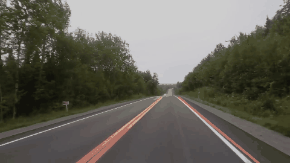
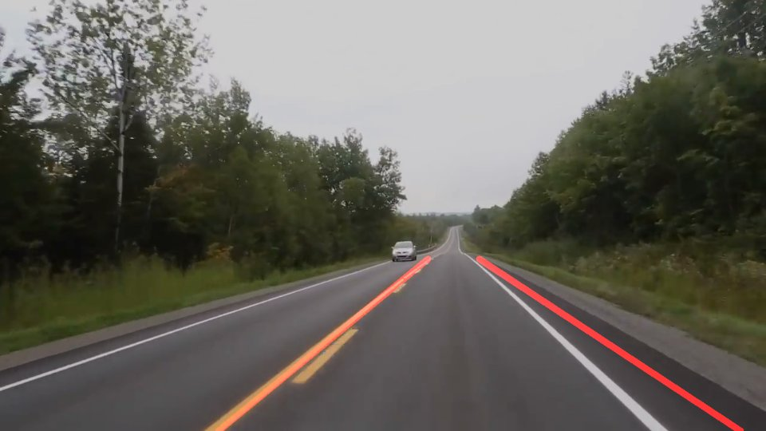

# Lane Detection System: Classical Computer Vision with OpenCV

Real-time road lane detection on dashcam video using a classical computer-vision pipeline: Canny edge detection, a region-of-interest mask, the probabilistic Hough transform and slope-based lane averaging. This is the perception building block behind lane-keeping assist (LKA) and lane-departure warning in driver-assistance systems.




---

## Pipeline


1. **Pre-processing:** convert to grayscale and apply a 5×5 Gaussian blur to suppress noise before edge detection.
2. **Edge detection:** Canny with hysteresis thresholds of 50 and 150.
3. **Region of interest:** a triangular mask keeps only the road area ahead of the car, removing trees, sky and roadside edges.
4. **Line detection:** the probabilistic Hough transform (ρ = 2 px, θ = 1°, threshold 100, min length 40 px, max gap 5 px) finds candidate lane segments.
5. **Lane averaging:** each segment is fitted with `np.polyfit`; negative slopes are assigned to the left lane and positive slopes to the right. Each side is averaged into one stable line.
6. **Extrapolation and overlay:** lines are extended from the bottom of the frame to 60% of its height and blended onto the original frame.



## Robustness

- Works with both OpenCV 4 (`HoughLinesP` returns `N×1×4`) and OpenCV 5 (`N×4`).
- If no segments are found for one side in a frame, the other lane is still drawn instead of the program crashing.
- Vertical segments, whose slope is undefined, are skipped.
- Tested on the included 781-frame, 1280×720 clip: lanes are drawn on every frame.

## Getting started

```bash
git clone https://github.com/yashdhokane/lane_assist_system.git
cd lane_assist_system
pip install -r requirements.txt
python laneDetection.py              # runs on the included test1.mp4
python laneDetection.py my_drive.mp4 # or on your own dashcam video
```

Press **q** to quit the video window.

## Limitations and next steps

The fixed triangular mask and straight-line model assume a forward-facing camera on a mostly straight road. Natural extensions:

- Perspective transform (bird's-eye view) and second-order polynomial fitting for curved lanes
- HLS colour thresholding to make yellow and white lines robust to shadows
- Temporal smoothing (e.g. exponential moving average or a Kalman filter) across frames
- A learned approach (e.g. a segmentation CNN such as LaneNet) for poor weather and night driving

## Author

**Yash Dhokane**, AI Engineer · MSc Artificial Intelligence, Heriot-Watt University
[LinkedIn](https://www.linkedin.com/in/yash-dhokane-3a914821b) · [GitHub](https://github.com/yashdhokane)
